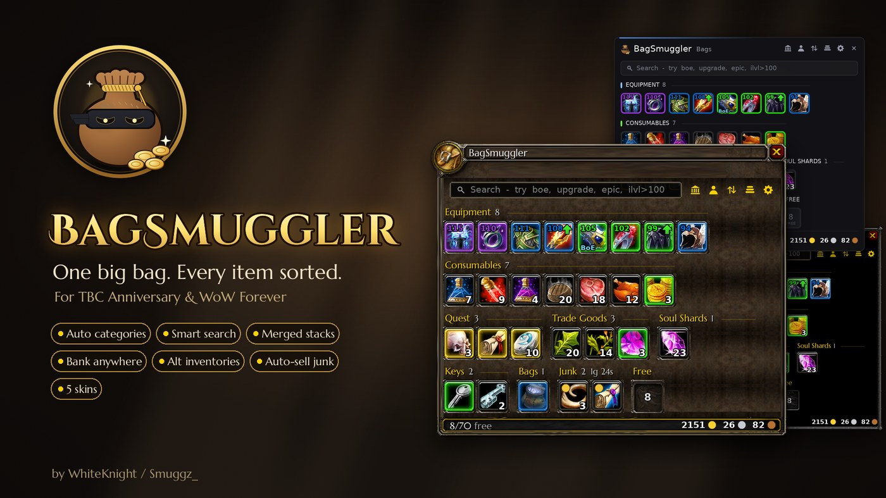
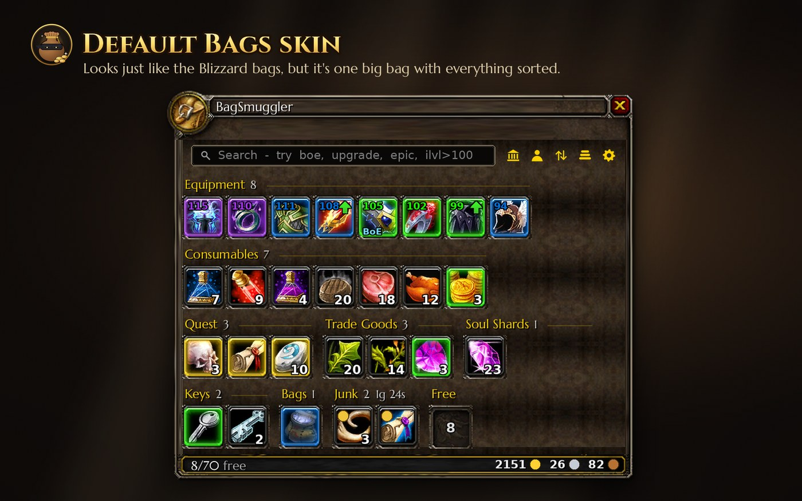
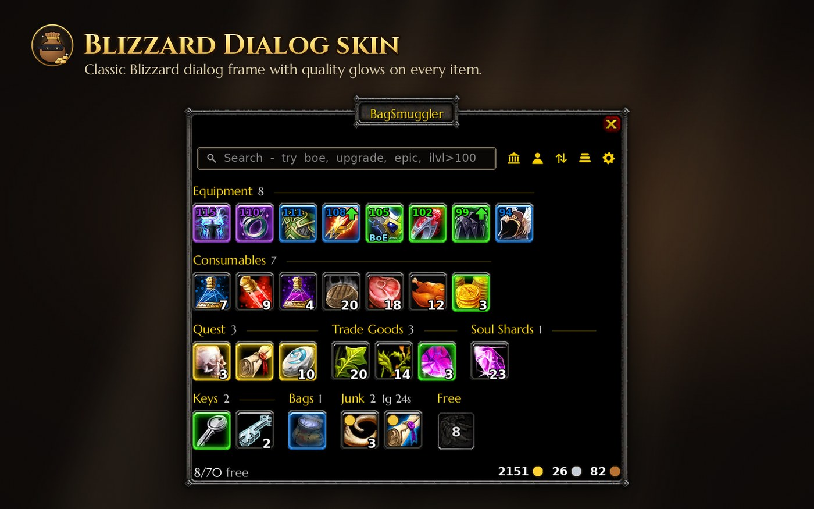
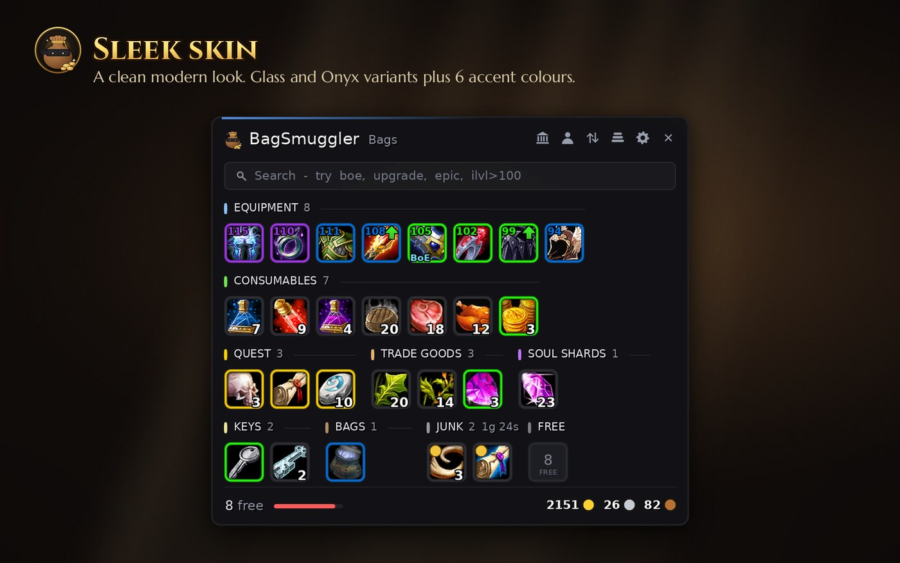

  

<h1 align="center">BagSmuggler</h1>

<b>One bag. Every item sorted.</b> 
An all-in-one bag addon for <b>TBC Classic Anniversary</b> and <b>WoW Forever</b>.

  

---

BagSmuggler replaces your separate bag windows with a single, organised inventory that looks just like the default Blizzard bags. Items are sorted into categories automatically, stacks are merged, and your bank and alts are always one click away.

## Features

| | |
|---|---|
| **Auto Categories** | Items are sorted into clear groups, with collapsible headers |
| **Merged Stacks** | One tile per item, showing the total count |
| **Smart Search** | Search by name, type, quality, item level and more |
| **Gear Insights** | Item level, class-aware upgrade arrows, BoE tags and quality borders |
| **Bank Anywhere** | View your bank from anywhere in the world |
| **Alt Inventories** | Browse every character's bags, bank and gold |
| **Junk Handling** | Auto-sells grey items, with custom junk marking |
| **Restack & Sort** | Combine partial stacks and sort categories in one click |
| **Combat Safe** | Items never move under your cursor mid-fight |
| **Five Skins** | Default Bags, Blizzard Dialog, Sleek, Glass and Onyx |

### Smart search filters

| Filter | Shows |
|---|---|
| `boe` / `bop` | Bind-on-equip or soulbound items |
| `upgrade` | Gear better than what you have equipped |
| `new` | Recently looted items |
| `junk` | Items marked for selling |
| `epic`, `blue`, `green` … | Items of that quality |
| `ilvl>100`, `i<=60` | Gear within an item-level range |

Filters can be combined, such as `epic boe`.

## Screenshots

**Default Bags skin**

**Blizzard Dialog skin**

**Sleek skin**

**Settings**

## Installation

**CurseForge:** install BagSmuggler through the CurseForge app.

**Manual:**
1. Download the latest zip from [Releases](../../releases).
2. Extract the `BagSmuggler` folder into your AddOns folder:
   - TBC Classic Anniversary: `World of Warcraft/_anniversary_/Interface/AddOns/`
   - WoW Forever: `Interface/AddOns/` inside your Forever install
3. Restart the game.

## Commands

| Command | Description |
|---|---|
| `/bsm` | Toggle your bags |
| `/bsm bank` | View your bank from anywhere |
| `/bsm config` | Open the settings window |
| `/bsm restack` | Combine partial stacks |
| `/bsm sell` | Sell junk at an open vendor |
| `/bsm reset` | Reset window positions |

**Alt + Right-click** an item to mark or unmark it as junk.

## Compatibility

| Client | Interface |
|---|---|
| TBC Classic Anniversary 2.5.6 | 20506 |
| WoW Forever (beta) | 16001 |

## Feedback & Bug Reports

Please open an [issue](../../issues) or message me on Discord: **whiteknight3187**.

## Licence

Copyright © 2026 WhiteKnight / Smuggz_. All rights reserved. See [LICENSE](LICENSE).
