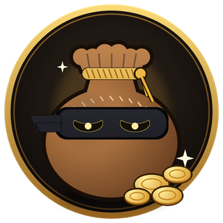
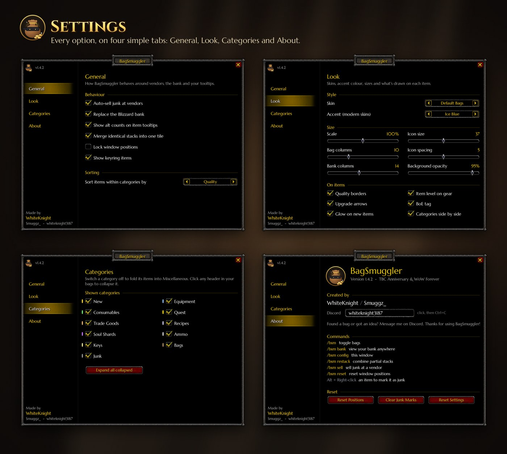
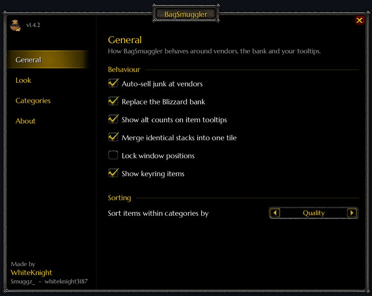
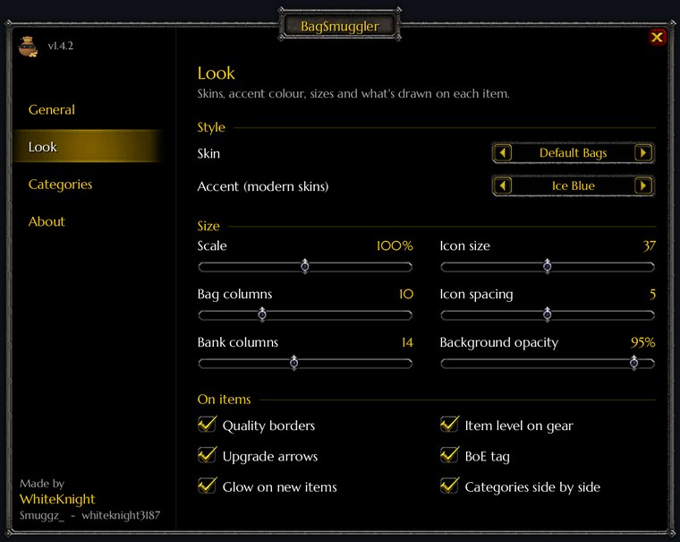
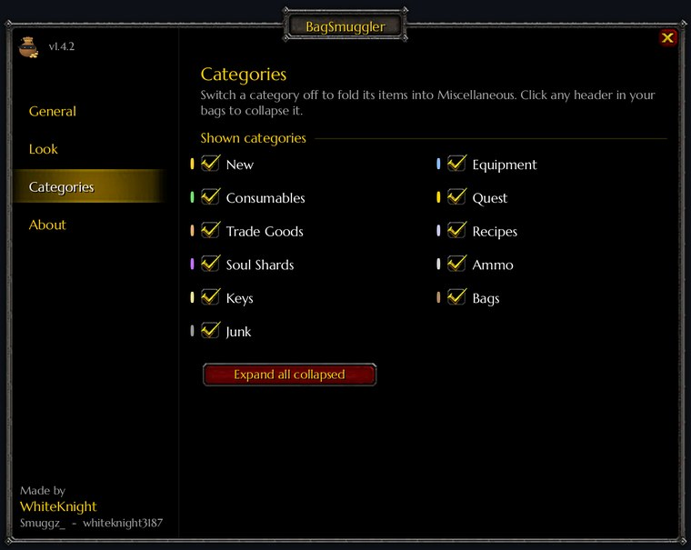
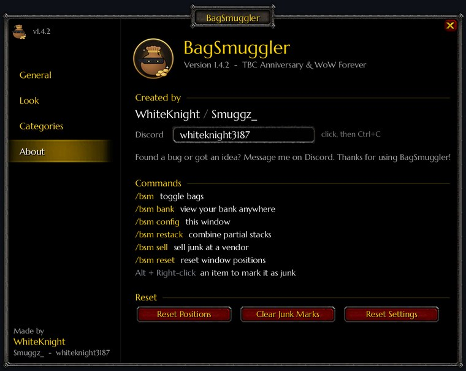

  

<h1 align="center">BagSmuggler</h1>

  <strong>One bag. Every item sorted.</strong> 
  All your bags in one window that looks just like the Blizzard bags, with everything sorted for you.

  
  
  
  
  

  

---

## Contents

- [What it does](#what-it-does)
- [Skins](#skins)
- [Smart search](#smart-search)
- [Gear at a glance](#gear-at-a-glance)
- [Bank and alts](#bank-and-alts)
- [Junk](#junk)
- [Built for combat](#built-for-combat)
- [Screenshots](#screenshots)
- [Installation](#installation)
- [Commands](#commands)
- [Settings](#settings)
- [Compatibility](#compatibility)
- [FAQ](#faq)
- [Bug reports](#bug-reports)
- [Credits and licence](#credits-and-licence)

## What it does

| | |
|---|---|
| **One big bag** | Every bag you carry, shown in a single window. No more opening five bags to find one potion. |
| **Auto categories** | Items are sorted into Equipment, Consumables, Quest, Trade Goods, Recipes, Soul Shards, Ammo, Keys, Bags, Miscellaneous and Junk, with new loot in its own **New** section. |
| **Collapsible sections** | Click any category header to fold it away. It stays folded between sessions. |
| **Merged stacks** | Identical items share one tile with the total count. 27 Soul Shards take one slot on screen, not three rows. |
| **Smart search** | Search by name, type or category, or filter by quality, item level, BoE, upgrades and more. |
| **Gear insights** | Item level, quality borders, class-aware upgrade arrows and BoE tags on every piece of gear. |
| **Bank anywhere** | A merged bank window, and your bank contents viewable from anywhere in the world. |
| **Alt inventories** | Browse any character's bags and bank, see item counts across all your characters on every tooltip, and every character's gold in one place. |
| **Junk handling** | Auto-sells grey items at vendors, lets you mark anything as junk, and shows how much your junk is worth. |
| **Restack & sort** | Combine partial stacks in one click, and sort categories by quality, item level, name or type. |
| **Five skins** | Default Bags, Blizzard Dialog, Sleek, Glass and Onyx. |

## Skins

<table>
  <tr>
    <td width="50%"> <b>Default Bags</b> (default). Built from the game's own bag art, so it looks just like the Blizzard bags, only bigger.</td>
    <td width="50%"> <b>Blizzard Dialog.</b> The classic Blizzard dialog frame, with quality glows on every item.</td>
  </tr>
  <tr>
    <td width="50%"> <b>Sleek.</b> A clean, modern dark theme. <b>Glass</b> (translucent) and <b>Onyx</b> (deep black) variants are included.</td>
    <td width="50%">
      <b>Modern skin accents</b>  
      Sleek, Glass and Onyx can be tinted with any of six accent colours:  
      Ice Blue · Fel Green · Gold · Void Purple · Rose · <b>Class Colour</b>  
      Every skin can also be resized: scale, columns, icon size, spacing and background opacity.
    </td>
  </tr>
</table>

## Smart search

Type in the search box and anything that doesn't match fades out. Plain words match item names, item types and category names. Filters narrow it down further:

| Filter | Shows |
|---|---|
| `boe` | Unbound bind-on-equip gear |
| `bop`, `bound`, `soulbound` | Soulbound items |
| `upgrade` | Gear better than what you have equipped |
| `new` | Items you've just looted |
| `junk` | Grey items and anything you've marked as junk |
| `gear` | Anything you can equip |
| `poor` `common` `uncommon` `rare` `epic` `legendary` | Items of that quality |
| `grey` `white` `green` `blue` `purple` `orange` | The same, by colour |
| `ilvl>100`, `ilvl<=60`, `i=115` | Gear within an item-level range |

Words combine, so `epic boe` shows only epic bind-on-equip gear. Use quotes for exact phrases, like `"mana potion"`. Hover the search box in game for a quick reminder.

## Gear at a glance

- **Item level** in the corner of every piece of gear, coloured by quality.
- **Quality borders** on uncommon and better items, with **quest items outlined in gold**.
- **Upgrade arrows** on gear with a higher item level than what you're wearing in that slot. They're **class-aware**, so a warlock never sees an arrow on plate or a mace, and they respect level requirements.
- **BoE tags** on unbound bind-on-equip gear, perfect for spotting things to sell on the Auction House.
- **New item glow** on fresh loot, which clears when you close your bags.

## Bank and alts

**The bank window.** Visiting a banker opens BagSmuggler's merged bank window, sorted into categories just like your bags. The original Blizzard bank is one click away (**Blizzard Bank**) for swapping bank bags, and there's a **Buy Slot** button while you have slots left to buy.

**Bank anywhere.** Your bank contents are saved each time you visit, so you can open them from anywhere with the bank icon or `/bsm bank`.

**Alt inventories.** Click the characters icon to view the bags or bank of any character you've logged into. Right-click a name in that list to forget the character.

**Item counts on tooltips.** Every item tooltip lists how many each of your characters on the realm holds, for example *Smuggz: Bags 5, Bank 20*, with a total.

**Gold across characters.** Hover your gold in the bag footer to see every character's gold and the realm total.

## Junk

- Grey items are **sold automatically** when you open a vendor (you can turn this off).
- **Alt + Right-click** any item to mark it as junk, or to rescue a grey item you want to keep.
- The **Junk** header shows the total vendor value, and a **Sell Junk** button appears at vendors.
- Only greys and items you've marked yourself are ever sold.

## Built for combat

Bags that rearrange themselves mid-fight are dangerous: you go to click a potion and it has moved. BagSmuggler **locks item positions in combat**. Buttons stay where they are, counts and cooldowns keep updating, and the full re-sort happens the moment combat ends.

If a merged stack tile runs out mid-fight (say you drank the last potion in that stack), another stack of the same item is moved into its place, so the tile you're clicking keeps working.

## Screenshots

  

<table>
  <tr>
    <td width="50%"> <b>General.</b> Junk selling, bank, tooltips, merged stacks and sorting.</td>
    <td width="50%"> <b>Look.</b> Skin, accent colour, sizes, and what's drawn on each item.</td>
  </tr>
  <tr>
    <td width="50%"> <b>Categories.</b> Switch any category on or off.</td>
    <td width="50%"> <b>About.</b> Credits, commands and reset buttons.</td>
  </tr>
</table>

## Installation

**CurseForge app:** search for **BagSmuggler** and click Install.

**Manually:**

1. Download the latest `BagSmuggler-x.x.x.zip` from the [Releases](../../releases) page.
2. Extract the `BagSmuggler` folder into your AddOns folder:
   - TBC Classic Anniversary: `World of Warcraft\_anniversary_\Interface\AddOns\`
   - WoW Forever: `Interface\AddOns\` inside your Forever install
3. Restart the game fully (not just `/reload`) so the textures load.

**First time on each character:** visit a banker once so that character's bank is saved for offline viewing.

## Commands

| Command | What it does |
|---|---|
| `/bsm` | Toggle your bags |
| `/bsm bank` | View your bank from anywhere |
| `/bsm config` | Open the settings window |
| `/bsm restack` | Combine partial stacks |
| `/bsm sell` | Sell junk at an open vendor |
| `/bsm reset` | Reset window positions |

`/bagsmuggler` works the same as `/bsm`. **Alt + Right-click** an item to mark or unmark it as junk.

### Window buttons

| Button | What it does |
|---|---|
| Bank | View your bank (bags window only) |
| Characters | View another character's bags or bank |
| Sort | Cycle sorting: Quality → Item Level → Name → Type |
| Restack | Combine partial stacks |
| Settings | Open the settings window |
| Category header | Click to collapse or expand that category |

## Settings

Open with `/bsm config`, the settings button on the bag window, or **Options → AddOns → BagSmuggler**.

### General

| Option | Default | |
|---|---|---|
| Auto-sell junk at vendors | On | Sells greys and items you've marked as junk |
| Replace the Blizzard bank | On | Uses BagSmuggler's bank window |
| Show alt counts on item tooltips | On | Item counts across your characters |
| Merge identical stacks into one tile | On | One tile per item with the total |
| Lock window positions | Off | Stops the windows being dragged |
| Show keyring items | On | TBC only |
| Sort items within categories by | Quality | Quality, Item Level, Name or Type |

### Look

| Option | Default | Range |
|---|---|---|
| Skin | Default Bags | Default Bags, Blizzard Dialog, Sleek, Glass, Onyx |
| Accent (modern skins) | Ice Blue | Ice Blue, Fel Green, Gold, Void Purple, Rose, Class Colour |
| Scale | 100% | 50–150% |
| Icon size | 37 | 26–48 |
| Bag columns | 10 | 6–20 |
| Bank columns | 14 | 6–24 |
| Icon spacing | 5 | 0–10 |
| Background opacity | 95% | 20–100% |
| Quality borders · Item level on gear · Upgrade arrows · BoE tag · Glow on new items | On | |
| Categories side by side | On | Off puts every category on its own row |

### Categories

New, Equipment, Consumables, Quest, Trade Goods, Recipes, Soul Shards, Ammo, Keys, Bags and Junk can each be switched off. Their items then fall into **Miscellaneous**.

## Compatibility

| | |
|---|---|
| **TBC Classic Anniversary** | 2.5.6 (interface 20506) |
| **WoW Forever** | Beta 1.60 (interface 16001). Support is newer and less tested; please report anything odd. |
| **Other bag addons** | Use one bag addon at a time. Disable Bagnon, AdiBags, ArkInventory and the like while using BagSmuggler. |

**Saved data** is stored per account in `BagSmugglerDB`. Item counts on tooltips cover the characters on your current realm.

## FAQ

**Will it sell anything I want to keep?**
No. Only grey items and items you've marked as junk are sold, and auto-selling can be switched off. Alt + Right-click a grey item to keep it.

**Why is another character's bank empty?**
Each character needs to visit a banker once so the bank can be saved.

**Why didn't my bags re-sort when I looted something mid-fight?**
That's deliberate. Items don't move during combat, so you never misclick. Everything sorts itself as soon as combat ends.

**How do I go back to the default Blizzard bags?**
Disable BagSmuggler in the AddOns list. The Blizzard bags come back immediately.

**Something looks off after updating.**
Fully restart the game rather than using `/reload`, so any new textures load.

## Bug reports

Please [open an issue](../../issues/new/choose) and include:

- the game client (TBC Anniversary or WoW Forever) and the BagSmuggler version;
- which skin you're using;
- any other bag, inventory or UI addons you use;
- the full error text (BugSack / BugGrabber output is ideal), and a screenshot for display problems.

See [CHANGELOG.md](CHANGELOG.md) for the full version history.

## Credits and licence

- **Created by:** WhiteKnight / Smuggz_ (Discord: **whiteknight3187**)

Copyright © 2026 WhiteKnight / Smuggz_. All rights reserved. BagSmuggler is free to download and use; please don't re-upload or redistribute it. See [LICENSE](LICENSE).

*World of Warcraft is a trademark of Blizzard Entertainment. This is a fan-made addon, not affiliated with Blizzard.*
